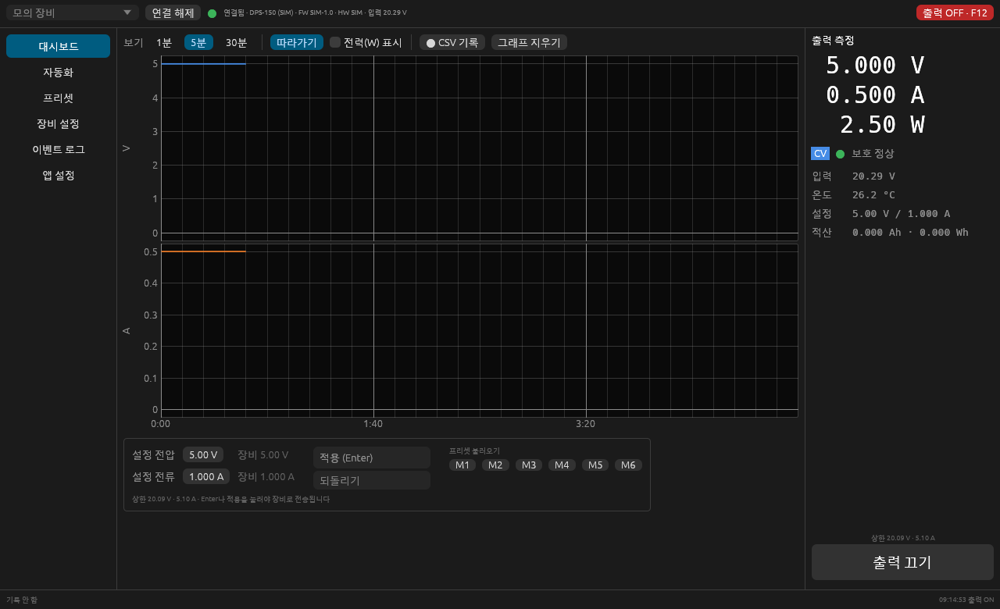

# power-supply

FNIRSI DPS-150 USB-C 프로그래머블 전원 공급기를 제어하는 Rust + egui 데스크톱 앱입니다. 공식 Windows 앱을 대체하며 Windows·macOS·Linux에서 빌드됩니다.

- 기획서: [docs/PLAN.md](docs/PLAN.md)
- 개발 지시서: [docs/DEVELOPMENT.md](docs/DEVELOPMENT.md)



## 기능

- 실시간 측정: 출력 V·A·W, 입력 전압, 온도, CV/CC, 보호 상태, Ah·Wh
- 전압·전류 설정: Enter나 「적용」을 눌러야 전송되고, 장비 한계값과 OVP/OCP로 클램프
- 출력 켜기: 확인창을 거치고, 설정값이 장비에 들어간 것을 확인한 뒤에만 켬
- 비상 출력 OFF: 상단 빨간 버튼, `F12`, `Esc` 두 번
- 실시간 그래프(1/5/30분)와 CSV 기록
- 자동화: 전압 스윕, 전류 스윕, 시퀀스(반복, 단계별 실행, CSV 가져오기·내보내기). 끝나거나 멈추면 출력 OFF
- 프리셋 M1–M6, 보호값 OVP·OCP·OPP·OTP·LVP, 화면 밝기, 적산
- 이벤트 로그와 CSV 내보내기, 공식 앱 `config.json` 가져오기
- 한국어·영어 UI, 다크·라이트 테마
- 모의 장비: 장비 없이 모든 기능을 시험

## 실행

```sh
cargo run -p dps150-ui --release
```

DPS-150이 연결되어 있으면 포트(VID 2E3C / PID 5740)가 자동으로 선택됩니다. 장비 없이 시험하려면 포트 목록에서 「모의 장비」를 고르거나 `--sim`을 붙입니다.

| 옵션 | 뜻 |
| --- | --- |
| `--sim` | 시작하면서 모의 장비에 연결 |
| `--port COM9` | 시작하면서 해당 포트에 연결 |
| `--page NAME` | 처음 열 페이지: dashboard, automation, sequence, presets, device, log, settings |
| `--lang ko\|en` | 언어 |
| `--screenshot PATH [--after SECS]` | 창을 PNG로 저장하고 종료 (개발용, 출력 상태를 바꾸지 않음) |

읽기 전용 하드웨어 점검: `cargo run -p dps150-device --example probe -- COM9`

## 구성

| crate | 역할 |
| --- | --- |
| `dps150-proto` | 시리얼 프레임 인코딩·디코딩, 상태 파서 (I/O 없음) |
| `dps150-device` | 시리얼 포트, I/O 스레드, `DeviceHandle` |
| `dps150-sim` | 모의 장비 (저항 부하 모델, 보호 동작) |
| `dps150-ui` | eframe/egui 데스크톱 앱 |

## 개발

```sh
cargo fmt --all --check
cargo clippy --workspace --all-targets -- -D warnings
cargo test --workspace
```
