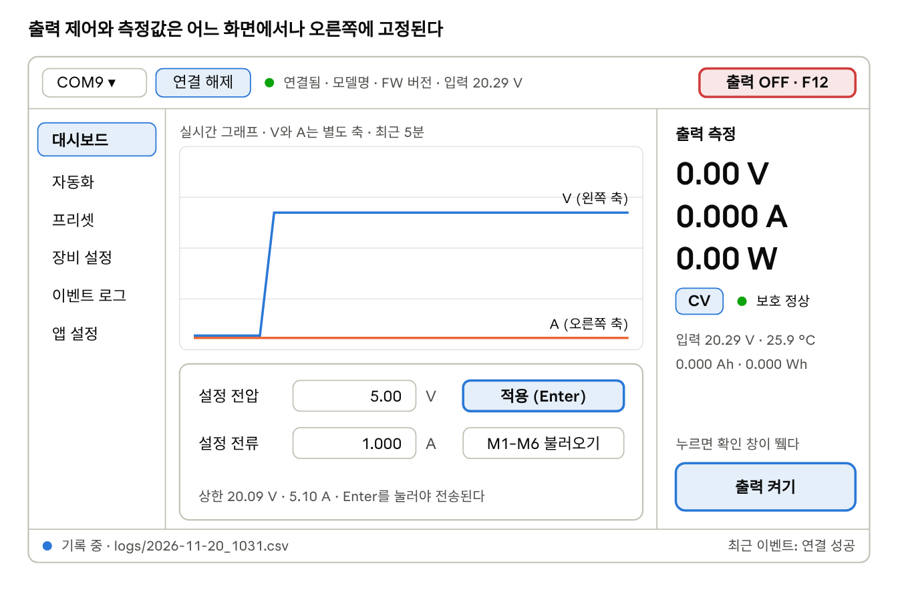
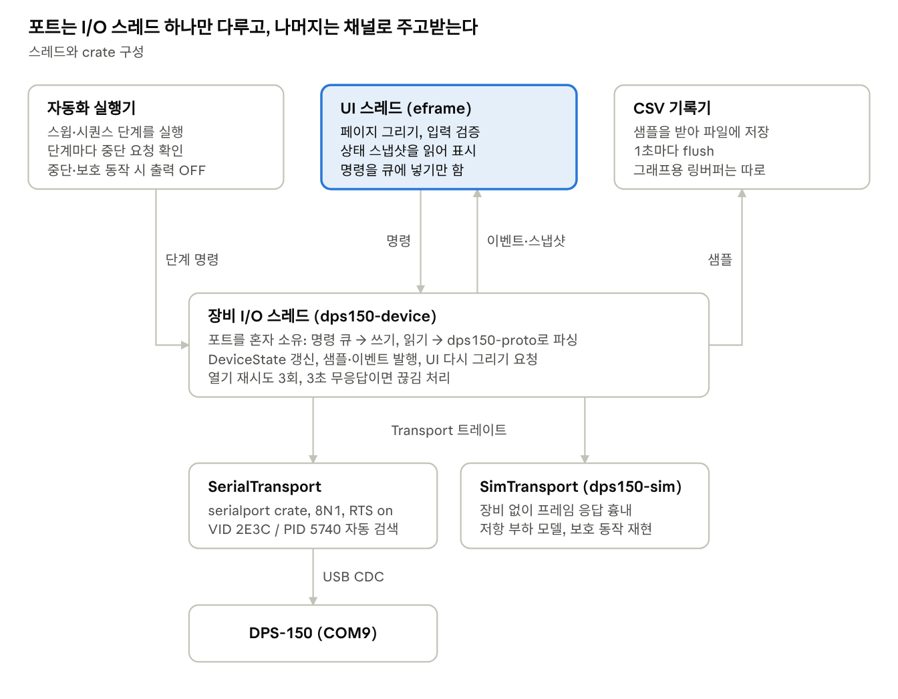
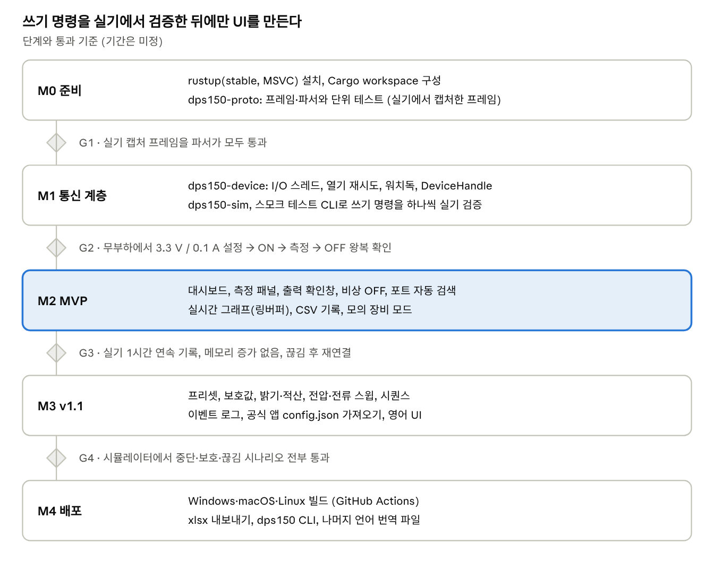

# DPS-150 제어 앱 기획서 (Rust + egui)

작성일: 2026-11-20

## 개요와 목표

FNIRSI 공식 PC 앱(Windows 전용 .NET WinForms)을 대체하는 Rust + egui 데스크톱 앱 **dps150-ui**(가칭)를 만든다. 단일 실행 파일로 Windows·macOS·Linux에서 동작하고, 공식 앱의 기능을 그대로 제공하면서 안전장치와 데이터 기록을 더한다.

**목표**

- 공식 앱과 기능 동등: 실시간 측정, 전압·전류 설정, 출력 on/off, 전압·전류 스윕, 시퀀스 실행
- 크로스플랫폼 단일 바이너리, 설치 없이 실행 (.NET 런타임 불필요)
- 실시간 그래프와 CSV 기록
- 안전 우선: 출력 켜기 확인, 한계값 클램프, 연결이 끊기면 안전 상태로 전환
- 통신 계층을 라이브러리 crate로 분리해 CLI와 자동화 스크립트에서도 재사용

**범위 밖 (1차)**

- 펌웨어 업데이트
- 여러 대 장비 동시 제어 (구조만 열어 둠)
- 웹·모바일 버전

## 기존 앱 분석

공식 앱 `FNIRSI Power supply.exe`는 .NET Framework 4 WinForms로 만들어졌다. Costura가 Newtonsoft.Json과 EPPlus를 exe 안에 넣어 두었고 코드 서명은 없다. ILSpy로 디컴파일해 화면과 동작을 확인했다. 내부 이름은 `数控电源上位机`(수치제어 전원 호스트 소프트웨어)이고, About 화면에 표시되는 버전은 V1.0.0.0(2023-12-21)이다.

**화면 구성**

- 테두리 없는 1280×760 창이다. 상단 바에 Basic / Advanced / Upgrade 탭, 시계, 설정 톱니바퀴(파라미터·언어·정보)가 있다
- 본문은 3열(50% / 20% / 30%)이다. 왼쪽 위는 그래프, 왼쪽 아래는 V/I 설정(Basic) 또는 시퀀스 표(Advanced)다. 가운데는 프리셋·적산·밝기(Basic) 또는 전압/전류 스윕(Advanced)이다. 오른쪽은 연결과 실시간 측정, 출력 버튼으로 항상 보인다
- 세부 설정(프리셋 편집, 보호값, 언어, 펌웨어)은 모두 반투명 오버레이 위의 모달 대화상자로 열린다

**기능**

| 영역 | 기능 |
| --- | --- |
| 연결 | COM 포트, 보레이트(9600–115200, 기본 9600), 장비 주소 1–255, 모델명·FW 표시 |
| 측정 | 입력V, 출력 V·I·P, 온도(°C/°F), 보호 상태 LED, CV/CC LED |
| 기본 제어 | 설정 V(0.01 단위)·I(0.001 단위), 출력 on/off |
| 프리셋 | Group 1–6 (V/I), 불러오기·장비에 저장 |
| 적산 | Ah·Wh 측정 on/off |
| 장비 설정 | 화면 밝기 1–14, 보호값 OVP·OCP·OPP·OTP·LVP |
| 자동화 | 전압 스윕, 전류 스윕, 10행 시퀀스(반복 1–999회, 시작·끝 번호, 자동/수동 단계) |
| 기록 | V·I 실시간 그래프, 메모리 기록 후 xlsx 내보내기 |
| 기타 | 7개 언어(한국어 포함), 펌웨어 BOOT 진입, About |

**config.json**: 언어, 스윕 2종의 설정, 시퀀스 반복 설정, 10행 표를 저장한다. `configScanV`의 `V`에는 실제로 고정 *전류*가, `startA/stopA/stepA`에는 *전압*이 들어 있어 이름이 뒤바뀌어 있다(`configScanA`는 반대). COM 포트와 보레이트는 저장하지 않는다.

**발견한 문제 (새 앱에서 고칠 것)**

- 숫자를 칠 때마다 즉시 전송한다. "24"를 입력하면 2 V가 간 뒤 24 V가 간다. 보호값과 밝기도 같다
- 출력을 켤 때 ON을 먼저 보내고 V/I를 나중에 보낸다
- 스윕 패널에서 출력이 꺼져 있을 때 **Stop을 눌러도 출력이 켜진다** (`UserPage5`)
- 스윕과 시퀀스가 확인 없이 출력을 켠다. 시퀀스를 일시정지하면 스윕을 동시에 시작할 수 있다
- 장비가 보낸 설정값을 화면에 넣으면 그 값이 다시 장비로 전송된다(에코 루프)
- 시리얼 스레드가 UI 컨트롤을 직접 고친다(교차 스레드 검사를 꺼 뒀다). 수신 조각이 프레임 중간에서 끊기면 데이터가 버려진다
- 그래프의 X축이 시간이 아니라 샘플 번호다. V와 A가 Y축 하나를 같이 쓰고, 데이터는 끊임없이 쌓인다
- 시퀀스 표는 10행으로 고정되어 있고, 상태 문구 "等待/运行中"는 번역되지 않는다

## 기능 요구사항

MVP는 「연결 → 측정 보기 → V/I 설정 → 출력 제어 → 그래프·기록」을 끝까지 안전하게 해내는 데 집중한다. 공식 앱의 나머지 기능은 v1.1에서 맞춘다.

| ID | 기능 | 공식 앱 대비 | 우선순위 |
| --- | --- | --- | --- |
| F1 | COM 포트 자동 검색 (VID 2E3C / PID 5740이면 자동 선택) | 신규 | MVP |
| F2 | 연결·해제, 열기 재시도, 끊김 감지 후 자동 재연결 | 개선 | MVP |
| F3 | 실시간 표시: 입력V, 출력 V·I·P, 온도, CV/CC, 보호 상태, 모델·FW | 동등 | MVP |
| F4 | V/I 설정: Enter나 「적용」을 눌러야 전송. 휠·화살표로 자릿수별 미세 조정 | 개선 | MVP |
| F5 | 출력 on/off: 확인 대화상자, 설정값을 먼저 보낸 뒤 ON | 개선 | MVP |
| F6 | 실시간 그래프: 시간축, V·I 별도 Y축, 최근 1/5/30분 보기, 링버퍼 | 개선 | MVP |
| F7 | CSV 기록: 파일에 바로 스트리밍 저장 (타임스탬프 ms) | 개선 (xlsx → CSV) | MVP |
| F8 | 모의 장비 모드: 장비 없이 UI·자동화 테스트 | 신규 | MVP |
| F9 | 프리셋 M1–M6: 보기, 불러오기, 장비에 저장 | 동등 | v1.1 |
| F10 | 보호값 OVP·OCP·OPP·OTP·LVP 설정 | 동등 | v1.1 |
| F11 | Ah·Wh 적산 on/off, 화면 밝기 1–14 | 동등 | v1.1 |
| F12 | 전압·전류 스윕: 소수점 지연, 진행률, 중단하면 출력 OFF | 개선 | v1.1 |
| F13 | 시퀀스: 행 수 제한 없음, 반복, 자동/단계 실행, CSV 가져오기·내보내기 | 개선 | v1.1 |
| F14 | 이벤트 로그: 연결, 출력 변경, 보호 동작을 시각과 함께 기록 | 신규 | v1.1 |
| F15 | 공식 앱 config.json 가져오기 (스윕 필드 이름이 뒤바뀐 것 보정) | 신규 | v1.1 |
| F16 | 한국어·영어 UI (나머지 5개 언어는 번역 파일로 추가) | 축소 | v1.1 |
| F17 | xlsx 내보내기 | 동등 | 이후 |
| F18 | `dps150` crate 기반 CLI와 스크립트 실행 | 신규 | 이후 |

펌웨어 BOOT 진입은 제외한다(안전 설계 참고).

**비기능 요구사항**

- Windows 10/11 x64가 1순위이고, macOS와 Linux도 빌드한다
- 단일 실행 파일, 설치나 런타임이 필요 없음
- 장비 프레임이 들어오는 속도(초당 수 회)로 그래프를 갱신하면서 UI는 60 fps를 유지한다
- 24시간 연속으로 기록해도 메모리가 늘어나지 않는다 (그래프는 링버퍼, 기록은 파일로)

## UI 설계

공식 앱의 구조는 그대로 가져간다. 측정값과 출력 버튼은 오른쪽에 고정하고, 가운데에서 페이지를 바꾼다. 다만 모달 대화상자 대신 좌측 메뉴 페이지를 쓰고, 비상 출력 OFF를 상단 바에 항상 둔다.



*대시보드 화면 목업 · 상단 바, 좌측 메뉴, 중앙 페이지, 우측 측정 패널, 하단 상태줄*

목업의 예시 값은 이번에 실제 장비에서 읽은 값이다. egui 패널 대응은 다음과 같다. 상단 바는 `TopBottomPanel::top`, 좌측 메뉴와 측정 패널은 `SidePanel`, 상태줄은 `TopBottomPanel::bottom`, 페이지는 `CentralPanel`이다.

| 페이지 | 내용 | 주요 위젯 |
| --- | --- | --- |
| 대시보드 | 실시간 그래프(V·A·W 표시 선택, 1/5/30분), V/I 설정 카드 | `egui_plot::Plot`, `DragValue` + 적용 버튼 |
| 자동화 | 탭 3개: 전압 스윕 / 전류 스윕 / 시퀀스. 실행 전에 계획된 단계를 그래프로 미리 보여주고, 실행 중에는 진행률과 현재 단계를 표시 | `egui_extras::TableBuilder`, `ProgressBar` |
| 프리셋 | M1–M6 카드 6개. 카드마다 불러오기와 편집 후 장비에 저장 | `Grid` |
| 장비 설정 | 보호값 5개, 화면 밝기, Ah·Wh 적산. 바뀐 항목을 강조하고 「장비에 쓰기」로 한 번에 전송 | `DragValue`, `Slider` |
| 이벤트 로그 | 연결, 출력 변경, 보호 동작, 오류를 시간순으로 표시하고 내보내기 | `TableBuilder` |
| 앱 설정 | 언어, 다크/라이트 테마, 확인창 사용 여부, 기록 폴더, 보레이트 | 기본 위젯 |

**공식 앱과 달라지는 점**

- 입력값은 키를 누를 때마다 보내지 않는다. Enter를 누르거나 「적용」을 눌러야 보낸다. 장비에 실제로 걸린 값과 화면에 입력된 값이 다르면 입력란을 표시해 알려준다
- 그래프는 X축이 시간이고 V와 A에 Y축을 따로 준다. 마우스를 올리면 그 시점의 값을 보여주고, 드래그하면 자동 따라가기가 풀린다
- 자동화가 실행되는 동안에는 대시보드의 V/I 설정을 잠근다
- 글꼴은 한글이 들어 있는 Noto Sans KR을 바이너리에 넣는다. 측정값 숫자는 고정폭 글꼴로 표시해 숫자가 바뀌어도 화면이 흔들리지 않게 한다

## 아키텍처

Cargo workspace 하나에 crate 4개를 둔다. 시리얼 포트는 장비 I/O 스레드 하나만 가지고, UI·자동화·기록기는 채널로만 명령과 데이터를 주고받는다. 그래서 공식 앱처럼 시리얼 스레드가 화면을 직접 고치는 일이 없다.



*스레드·crate 구성 · UI, 자동화, 기록기는 채널로 I/O 스레드와 통신*

UI가 멈춰도 통신과 기록은 계속 돌고, 시뮬레이터를 끼우면 장비 없이도 같은 경로로 테스트할 수 있다.

| crate | 역할 | 주요 의존성 |
| --- | --- | --- |
| `dps150-proto` | 프레임 인코딩·디코딩, 데이터 타입 enum, 전체 상태 파서. I/O 없음 | `thiserror` |
| `dps150-device` | `Transport` 트레이트, 시리얼 구현, I/O 스레드, 연결 관리, `DeviceHandle` API | `serialport`, `crossbeam-channel`, `tracing` |
| `dps150-sim` | 모의 장비: 프레임에 응답하고 저항 부하를 가정해 V·I를 만든다 | `dps150-proto` |
| `dps150-ui` | eframe 앱: 페이지, 자동화 실행기, CSV 기록기, 설정 | `eframe`, `egui_plot`, `egui_extras`, `serde`, `csv`, `directories` |

**핵심 타입**

```rust
pub enum Command {
    SetVoltage(f32), SetCurrent(f32), Output(bool),
    SetPreset { slot: u8, v: f32, i: f32 },
    SetProtection(Protection, f32), SetBrightness(u8), Metering(bool),
    RequestAll,
}

pub enum Event {
    Connected(DeviceInfo), Disconnected(Reason),
    Sample(Sample),          // t, vout, iout, pout
    State(DeviceState),      // 0xFF 전체 상태
    Protection(ProtState),   // OVP/OCP/OPP/OTP/LVP
}
```

**상태와 설정**

- 최신 `DeviceState`는 `Arc<RwLock<_>>`에 두고 UI가 프레임마다 읽는다. 그래프 데이터는 고정 크기 링버퍼(30분치)에 넣는다
- I/O 스레드는 새 데이터가 오면 `ctx.request_repaint()`를 부른다. 그래서 화면이 가만히 있을 때는 CPU를 거의 쓰지 않는다
- 앱 설정(마지막 포트, 언어, 스윕·시퀀스, 창 크기)은 `directories`가 알려주는 OS 설정 폴더에 `config.json`으로 저장한다. 프리셋과 보호값은 장비가 기준이다
- 자동화 계획은 `Vec<Step { v, i, hold: Duration }>`으로 만든다. 스윕도 시퀀스도 같은 실행기가 돌리고, 미리보기 그래프도 이 계획으로 그린다

## 통신 프로토콜과 시리얼 계층

장비는 USB CDC 가상 COM 포트(VID 2E3C, PID 5740) 위의 단순 바이너리 프레임으로 통신한다. 아래 내용은 공식 앱을 디컴파일해 확인했고(`Command.cs`, `CmdMoudle.cs`, `SerialData.cs`, `Serial.cs`), 실제 장비에서 읽기 명령으로 검증했다.

**프레임 형식**

| 바이트 | 내용 |
| --- | --- |
| 0 | 헤더: 송신 `0xF1`, 수신 `0xF0` |
| 1 | 명령: `0xA1` GET, `0xB1` SET, `0xB0` 보레이트, `0xC1` 세션, `0xC0` 부트로더 |
| 2 | 데이터 타입 (아래 표) |
| 3 | 페이로드 길이 N |
| 4 .. 3+N | 페이로드 (float는 little-endian f32) |
| 4+N | 체크섬 = (타입 + N + 페이로드 합) mod 256 |

**데이터 타입**

| 코드 | 항목 | 형식 | 접근 |
| --- | --- | --- | --- |
| 0xC0 (192) | 입력 전압 | f32 V | 읽기 |
| 0xC1 (193) | 설정 전압 | f32 V | 읽기/쓰기 |
| 0xC2 (194) | 설정 전류 | f32 A | 읽기/쓰기 |
| 0xC3 (195) | 출력 V·I·P | 3×f32 | 읽기 (장비가 주기적으로 보냄) |
| 0xC4 (196) | 내부 온도 | f32 °C | 읽기 |
| 0xC5–0xD0 (197–208) | 프리셋 M1–M6 | f32, Mn의 V = 195+2n, I = 196+2n | 읽기/쓰기 |
| 0xD1–0xD5 (209–213) | 보호 OVP·OCP·OPP·OTP·LVP | f32 | 읽기/쓰기 |
| 0xD6 (214) | 화면 밝기 | u8 | 읽기/쓰기 |
| 0xD8 (216) | Ah·Wh 적산 시작/정지 | u8 | 쓰기 |
| 0xD9 / 0xDA (217/218) | 적산 용량 Ah / 에너지 Wh | f32 | 읽기 |
| 0xDB (219) | 출력 on/off | u8 | 읽기/쓰기 |
| 0xDC (220) | 보호 상태: 0 정상, 1 OVP, 2 OCP, 3 OPP, 4 OTP, 5 LVP | u8 | 읽기 |
| 0xDD (221) | 모드: 0 CC, 1 CV | u8 | 읽기 |
| 0xDE / 0xDF / 0xE0 (222–224) | 모델명 / HW 버전 / FW 버전 | 문자열 | 읽기 |
| 0xE1 (225) | 장비 주소 1–255 (연결 확인용) | u8 | 읽기 |
| 0xE2 / 0xE3 (226/227) | 최대 설정 가능 V / A | f32 | 읽기 |
| 0xFF (255) | 전체 상태 스냅샷 (139바이트 이상) | 복합 | 읽기 |

전체 상태(0xFF) 페이로드 오프셋: 0 입력V, 4 설정V, 8 설정I, 12/16/20 출력 V·I·P, 24 온도, 28–75 프리셋 M1–M6, 76–92 보호값 5개, 96 밝기, 97 미상(볼륨 추정), 98 적산 상태, 99 Ah, 103 Wh, 107 출력, 108 보호 상태, 109 CC/CV, 111/115 최대 V/A, 119–135 보호값 상한 5개.

**연결 절차 (공식 앱 기준)**

1. 포트 열기: 8N1, RTS on, 사용자가 고른 보레이트 (기본 9600, 최대 115200)
2. 세션 시작 `F1 C1 00 01 01 02`
3. 장비 주소(0xE1) 요청을 1초 간격으로 최대 2회 보낸다. 응답 값이 사용자가 입력한 주소와 다르거나 응답이 없으면 「연결 실패」
4. 보레이트 설정(0xB0, 인덱스 1–5) 후 모델명, FW, HW, 전체 상태를 차례로 요청
5. 이후 측정값은 장비가 스스로 보낸다(푸시). 앱은 수신 이벤트에서 프레임을 나눠 처리
6. 종료 시 세션 종료 `F1 C1 00 01 00 01`

**Rust 시리얼 계층 설계**

- `serialport` crate로 포트를 열고 전용 I/O 스레드 하나가 읽기·쓰기를 모두 맡는다
- 수신 버퍼는 스트리밍 파서로 처리한다. `0xF0`을 찾고, 길이만큼 모은 뒤, 체크섬이 틀리면 1바이트 밀어서 다시 싱크한다. 공식 앱은 수신 조각이 프레임 경계에서 잘리면 예외를 삼켜 버리므로 이 부분을 개선한다
- 열기 재시도: 이 PC에서는 매번 첫 포트 설정이 Windows 오류 995(I/O 취소)로 실패하고 두 번째에 성공했다. 300 ms 간격으로 최대 3회 재시도한다
- 상태 동기화: 푸시 데이터에 더해, 1초마다 전체 상태(0xFF)를 요청해 설정값 변화를 확인한다
- 워치독: 3초 동안 아무 프레임도 오지 않으면 연결 끊김으로 판단한다
- `0xC0` 부트로더 진입 명령은 1차 범위에서 제외하고, 코드에도 노출하지 않는다

## 안전 설계

이 앱은 실제 회로에 최대 20 V·5 A를 걸 수 있다. 그래서 출력에 영향을 주는 모든 동작은 「값 검증 → 설정값 전송 → 출력 켜기」 순서를 지킨다.

| 위험 | 공식 앱 동작 | dps150-ui 동작 |
| --- | --- | --- |
| 출력을 켤 때 이전 설정값이 잠깐 걸림 | 출력 ON을 먼저 보내고 그 다음에 V/I를 보냄 (`UserPage4.openOutput`) | V/I를 먼저 보내고, 장비가 돌려준 설정값이 맞는지 확인한 뒤 ON을 보냄 |
| 실수로 출력 켜기 | 버튼 한 번 | 확인 대화상자에 설정 V/I를 크게 표시. 「다시 묻지 않기」는 세션 단위로만 기억 |
| 범위를 벗어난 값 입력 | 입력 상자 최댓값을 0xE2/0xE3으로 갱신 | 최대 V/A와 OVP/OCP 중 작은 값으로 클램프한다. 클램프되면 입력란에 경고를 표시 |
| 큰 폭의 전압 변경 | 제한 없음 | 출력이 켜진 상태에서 5 V 이상 올리면 한 번 더 확인 (설정에서 끌 수 있음) |
| 스윕·시퀀스 중 앱 종료·연결 끊김 | 출력이 마지막 값으로 남음 | 출력을 끄고 세션을 종료한다. 연결이 끊어지면 재연결 즉시 OFF를 보낸다 |
| 보호 동작(OVP 등) | 하단 정보줄에 문구 표시 | 빨간 배너 + 이벤트 로그에 시각·측정값 기록. 스윕/시퀀스는 자동 중단 |
| 부트로더 진입(0xC0) | BOOT 버튼 한 번 | 1차에서는 기능 제외 |

**실행 중단 수단**

- 어느 화면에서나 보이는 빨간 「출력 OFF」 버튼. 단축키는 `Esc`를 두 번 누르거나 `F12`
- 앱이 패닉하거나 창을 닫으면 `Drop`에서 출력 OFF와 세션 종료를 시도한다
- 자동화(스윕·시퀀스) 실행기는 단계마다 중단 요청을 확인하고, 중단되면 출력을 끄는 것이 기본값이다

## 개발 계획

개발은 5단계로 나눈다. 단계마다 통과 기준이 있고, 쓰기 명령을 실기에서 검증(G2)하기 전에는 UI 작업을 시작하지 않는다. 기간은 아직 정하지 않았다.



*개발 단계 M0–M4와 통과 기준 G1–G4*

**테스트 전략**

- 단위 테스트 (`dps150-proto`): 프레임 인코딩↔디코딩 왕복과 체크섬을 확인한다. 실기에서 캡처한 전체 상태 프레임으로 파서를 검사한다. 수신 스트림을 아무 위치에서나 자르거나 잇는 속성 테스트(`proptest`)도 넣는다
- 통합 테스트 (`dps150-device` + `dps150-sim`): 연결, 첫 열기 실패 후 재시도, 무응답 시 끊김 처리, 재연결, 보호 이벤트를 확인한다
- 자동화: 스윕 계획을 경계값(시작=끝, 단계>범위, 상한 초과)으로 만들어 본다. 중단·보호·끊김이 일어나면 항상 출력 OFF가 나가는지 검사한다
- UI: 핵심 화면은 `egui_kittest`로 스냅샷을 찍고, 출력 확인창과 입력 클램프 동작을 검사한다
- 실기 체크리스트: 무부하 상태에서 먼저 돌리고, 알고 있는 저항 부하를 달아 CC 전환과 OCP 동작을 확인한다. 출력 단자에 무엇을 연결할지는 테스트 때마다 담당자가 정한다
- CI: GitHub Actions에서 Windows, macOS, Ubuntu에 대해 `fmt`, `clippy`, 테스트를 돌린다

## 리스크와 미결 사항

| 항목 | 영향 | 대응 |
| --- | --- | --- |
| 쓰기 명령을 실제 장비에서 아직 검증하지 않음 | 설정·출력 제어가 어긋날 수 있음 | M1 동안 무부하 상태에서 3.3 V / 0.1 A로 명령마다 왕복 테스트 |
| 펌웨어 버전마다 프로토콜이 다를 수 있음 | 오프셋·타입 불일치 | 연결 시 FW 버전을 기록하고, 모르는 버전이면 경고 |
| 전체 상태 오프셋 97 등 의미 미상 | 표시 누락 | 미상 필드는 디버그 패널에 원시 값으로만 노출 |
| Windows 오류 995 (첫 포트 설정 실패) | 연결 실패처럼 보임 | 열기 재시도 3회, 원인은 M1에서 따로 조사 |
| 공식 앱과 COM 포트 동시 사용 불가 | 열기 실패 | 「포트를 다른 프로그램이 사용 중」 오류를 구분해서 표시 |
| 공식 앱의 이미지·아이콘 저작권 | 재배포 불가 | 화면 구성만 참고하고 그래픽은 egui 기본 위젯으로 새로 만든다 |
| 이 PC에 Rust 툴체인이 없음 | 개발 착수 지연 | M0에서 rustup으로 설치 (stable, MSVC) |

**미결 사항**

- [ ] 이 장비의 주소(0xE1) 값 확인. 공식 앱은 사용자가 입력한 주소와 비교하지만, 새 앱은 응답값을 그대로 표시할지 결정 필요
- [ ] 보레이트: 공식 앱 기본값은 9600이고 오픈소스 라이브러리는 115200을 쓴다. CDC 장치라 실제로 의미가 있는지 확인 필요
- [ ] 화면 밝기 외에 볼륨(0xD7 추정) 쓰기 명령이 있는지
- [ ] 앱 이름과 배포 방식 (개인용 vs 공개 저장소)
